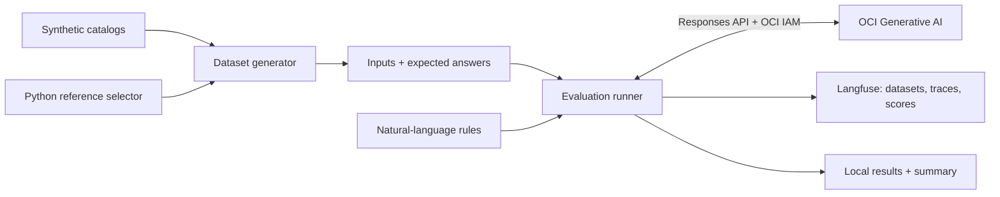

# Agent Evals: Automotive Express Order

**Measure how reliably an LLM selects the best supplier offer using natural-language business rules.**

This demo takes an automotive procurement decision from a synthetic test case to a scored experiment in Langfuse. The model runs on **OCI Generative AI through the Responses API**. An independent Python reference selector supplies the correct answers, making every selection directly verifiable.

**100 cases · 6 offers per case · 10 scenarios · 50 suppliers · 100 parts · 10 plant locations**

## The business problem

A car manufacturer operates multiple plants. When a plant's stock of a production part drops, it initiates an **Express Order** and invites suppliers to submit offers. The agent identifies the best offer for the requested part, destination, and delivery deadline.

The demo focuses on **offer selection**. Requests and collected offers are supplied as JSON; stock monitoring, supplier invitations, purchase-order placement, and delivery execution are outside its scope. Plant destinations are represented by European cities, including Rome.

The selection rules are simple and inspectable:

1. Match the requested **part ID** and **delivery city** exactly.
2. Deliver **strictly before** the deadline. Delivery on the deadline is excluded.
3. Choose the eligible offer with the **lowest total cost in euros**.
4. If costs are equal, choose the **earliest delivery date**.

Every offer identifies its supplier. Supplier identity does not affect ranking. Each generated case has at least one eligible offer and a unique winner.

## What the demo demonstrates

The goal is to build a reproducible evaluation workflow for an agent with a well-defined task:

* **Separate rules from code.** The model reads a [natural-language rule file](rules/offer-selection.md).
* **Create reliable ground truth.** A [deterministic reference selector](src/agent_evals/selection.py) labels and validates the synthetic dataset. The LLM makes its own selection during evaluation.
* **Exercise specific failure modes.** Cases include cheap but ineligible offers, excluded deadline dates, cost ties, and one-cent differences.
* **Compare experiments.** Record model outputs, traces, and scores in Langfuse to assess changes to models or prompts on the same cases.

This task has an exact reference answer, so evaluation uses a Python comparison rather than an LLM judge. It provides a small, understandable setting for studying rule adherence and evaluation design.

## From dataset to experiment



Only the rules and case input go to the model. Expected answers and scenario metadata stay with the evaluation runner.

## Reuse the pipeline for another task

OCI access, pacing, progress, results, diagnostics, and Langfuse tracking are shared. Express Order-specific validation, prompt construction, response parsing, and scoring live in [one task adapter](src/agent_evals/tasks/offer_selection.py).

To adapt the pipeline, supply a task module exporting `TASK`, a rules file, and a dataset with its manifest. Select the module with `--task`; existing commands default to Express Order. A separate classification fixture verifies the same pipeline with plain text inputs, label outputs, and a different score name.

See [Adapting the runner to another task](docs/adapting-tasks.md) for the four callbacks, examples, and the version 2 result format. The reusable contract currently supports binary correctness scoring.

## Dataset and scoring

The [synthetic dataset](data/datasets/express-order-v1.json) contains **100 cases with six offers each**, generated from the local catalogs using a fixed seed. Every part is requested once; each plant city appears in ten requests. Supplier names and costs are illustrative, and the locations represent hypothetical plants.

| Scenario | Cases |
| --- | ---: |
| All offers eligible, with distinct costs | 10 |
| A cheaper offer has the wrong part | 10 |
| A cheaper offer has the wrong delivery city | 10 |
| A cheaper offer delivers on the excluded deadline | 10 |
| A cheaper offer delivers after the deadline | 10 |
| Two offers tie on lowest cost | 10 |
| Three offers tie on lowest cost | 10 |
| Lower cost wins over earlier delivery | 10 |
| A one-cent price difference decides the winner | 10 |
| Mixed eligibility failures leave one valid offer | 10 |

Offer order is shuffled and winning positions are balanced. The split reserves **20 development cases** for prompt work and **80 held-out evaluation cases**, with every scenario represented in both. Cases with no eligible offer or an unresolved cost-and-date tie are excluded from this initial dataset.

The model returns `{"selected_offer_id": "..."}`. The evaluator compares it with `expected_output.expected_offer_id`:

* **1** for an exact match; **0** for a different valid selection.
* **Selection accuracy:** correct selections divided by valid scored cases.
* **Overall success rate:** correct selections divided by all attempted cases.

Malformed output, unknown offer IDs, and API failures are reported separately and cannot count as successes. Summaries include attempt, failure, and unattempted counts. No experiment-level pass threshold has been set.

## Tools and Langfuse integration

| Tool | Role in the demo |
| --- | --- |
| Python 3.11 and Conda | Local development and experiment execution |
| OCI Generative AI Responses API | Model inference using the configured region, model, and project |
| OpenAI Python SDK, HTTPX, and `oci-genai-auth` | Responses client with OCI IAM signing through `~/.oci/config` |
| Langfuse Cloud and Python SDK | Hosted datasets, experiments, generation traces, and evaluation scores |
| JSON catalogs and datasets | Inspectable synthetic inputs and reference answers |
| pytest | Offline correctness, coverage, and integration-contract tests |
| tqdm | Evaluation progress alongside per-case status messages |

Langfuse receives the selected dataset cases, their expected outputs, model traces, and scores: `selection_correct`, `valid_output`, and `execution_status`. Experiments can be inspected and compared in its UI. Local JSONL results and a summary are also saved for every run.

The runner uploads only the selected cases and uses stable dataset-item identifiers for repeat runs. It executes one model call at a time, with a configurable pause between calls, including after failures. Langfuse Cloud is the initial destination; its configurable URL supports a future self-hosted instance on OCI.

## Try it

Run commands from the repository root. If the environment does not exist, create it first:

```sh
conda create -n agent-evals python=3.11
conda activate agent-evals
python -m pip install -r requirements.txt
```

### 1. Check the code and dataset offline

These checks make no model calls or Langfuse uploads and need no credentials:

```sh
python -m pytest -q
PYTHONPATH=src python -m agent_evals.evaluate --experiment-name validation --dry-run --split all
```

### 2. Configure live access

Create `.env` using [.env.example](.env.example) as a reference. Set `OCI_REGION`, `OCI_MODEL`, `OCI_PROJECT_ID`, and your Langfuse URL and keys. Configure an OCI user-principal signing profile in `~/.oci/config`; the default profile is `DEFAULT`.

Inference authenticates with the OCI signing key referenced by that profile. See the [setup guide](docs/evaluation.md) for permissions, variables, and supported client versions. `.env` and generated run outputs are ignored by Git.

### 3. Run a development smoke test

This invokes OCI and publishes one selected synthetic case and its evaluation to Langfuse:

```sh
./run_experiment.sh "Express Order smoke test" --split development --limit 1
```

### 4. Evaluate the held-out cases

```sh
./run_experiment.sh "Express Order baseline" --split evaluation --sleep-seconds 5
```

The root-level `run_experiment.sh` requires the experiment name as its first argument and forwards the remaining options to the Python CLI in the `agent-evals` Conda environment. The Python CLI requires `--experiment-name` (`--run-name` is an alias), including for dry runs. This name is used unchanged as the Langfuse experiment name; each execution has a unique run-name suffix.

The runner defaults to the 80 evaluation cases. Use `--split all` to explicitly include all 100 cases, or `--no-langfuse` for OCI evaluation with local results only. Set `EVAL_SLEEP_SECONDS` in `.env` to change the default two-second pause; `--sleep-seconds` overrides it.

Results are saved under `data/runs/<run-id>/` as `metadata.json`, `results.jsonl`, and `summary.json`. Version 2 results store task answers in `output` and references in `expected_output`; summaries report `accuracy`, task identity, and metric name. The summary includes the Langfuse experiment URL when available. Publication is marked `submitted_unverified` until persistence is independently checked; ingestion is asynchronous.

## Validation status

As of **2026-11-08**, **56 automated tests pass**, including cross-task execution with mocked OCI and Langfuse clients. Before the reusable-task refactor, a one-case development smoke test successfully called OCI Responses using IAM signing, selected the expected offer, and published the dataset item, experiment, and scores to Langfuse. Persistence was verified through its read API. The refactor has been verified offline; no new live run has been performed for it.

This confirms the integration on one development case. A full-dataset accuracy result has not yet been measured.

## Explore the project

* [Why evals matter: the demo, synthetic data, Langfuse workflow, and reuse](https://github.com/luigisaetta/agent-evals/blob/main/docs/evals-for-agentic-solutions.md)
* [Evaluation setup, outputs, and operational details](docs/evaluation.md)
* [Adding another use case with a task adapter](docs/adapting-tasks.md)
* [Dataset coverage, format, and regeneration](data/datasets/README.md)
* [Supplier, part, and plant-location catalogs](data/catalogs/README.md)
* [Task specification and JSON example](specs/offer-selection.md)
* [Dataset generation specification](specs/synthetic-dataset.md)
* [Evaluation runner specification](specs/evaluation-runner.md)
* [Changelog](CHANGELOG.md)

## License

This project is licensed under the [MIT License](LICENSE).
