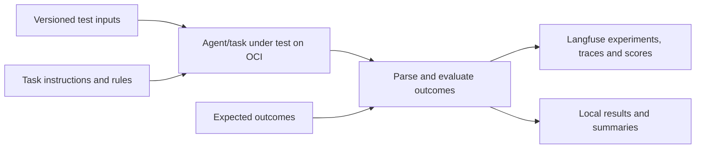

# Agent Evals

**A practical exploration of systematic evaluation for AI agents.**

This project explores how to define, run, and interpret evaluations of an agent's performance using a concrete business example. It brings together explicit expectations, reproducible test cases, model execution, automated scoring, and experiment tracking to make agent behavior measurable and inspectable.

The initial implementation evaluates one well-defined task within an agent. Models are invoked through **OCI Generative AI Responses API**, while **Langfuse** connects test cases, execution traces, and scores. A reusable Python runner separates the evaluation workflow from the business-specific task.

**Define expectations → build a dataset → execute the task → score outcomes → inspect and compare experiments.**

## What we want to explore

The objective is to understand how evals can support the development of agentic solutions:

* **Define correctness.** Translate a business requirement into an input/output contract and observable success criteria.
* **Build useful test cases.** Cover normal behavior, constraints, boundary conditions, and likely failure modes.
* **Measure behavior systematically.** Evaluate a set of cases with explicit scoring rather than relying on a few successful interactions.
* **Investigate failures.** Distinguish incorrect decisions, invalid responses, infrastructure failures, and evaluator errors.
* **Compare changes.** Use the same cases and evaluator definitions to assess different prompts, models, or implementations.
* **Reuse the approach.** Adapt the task-specific parts while retaining the execution and observability pipeline.

The current eval measures task correctness and execution outcomes. It also records per-case latency and available token usage for inspection. It does not calculate monetary inference cost or provide a comprehensive benchmark of an entire agent.

## The evaluation workflow

A useful eval starts with the expected behavior, before the first model call. This repository implements the following loop:

1. **Specify the task and rules.** Make inputs, constraints, outputs, and success criteria explicit.
2. **Create reference cases.** Store test inputs and independently established expected outcomes separately.
3. **Separate development and evaluation.** Use development cases for iteration and held-out cases for assessment.
4. **Run a named experiment.** Execute the model-backed task with recorded configuration and controlled request pacing.
5. **Validate and score each answer.** Keep parsing, domain correctness, and execution failures distinguishable.
6. **Inspect the evidence.** Review aggregate metrics, individual failures, and their traces before deciding what to change.



Expected outcomes and scenario metadata stay outside the model prompt. The current task has exact reference answers, so scoring uses deterministic Python code. The LLM makes the decision being evaluated.

Offline software tests and live evals provide different evidence: tests check that the generator, parser, scorer, and runner work correctly; live experiments measure whether the model-backed task produces the expected business results.

## What Langfuse adds

Langfuse makes an experiment inspectable beyond its final aggregate score. In this implementation it holds:

| Artifact | Purpose |
| --- | --- |
| Hosted dataset items | Connect case inputs, expected outputs, and scenario metadata |
| Named experiments | Identify executions and compare changes on the same cases |
| Generation traces | Inspect instructions, inputs, raw outputs, model identity, and available token usage |
| Correctness scores | Record whether each scored answer meets the task's expectation |
| Validity and status scores | Separate valid output from model, API, and evaluator failures |

The runner publishes a task-specific correctness metric alongside shared `valid_output`, `execution_status`, and `case_success` scores; `case_success` is 0 for every KO case, so its average is the success rate over all attempts. A task can add binary scores for intermediate steps, such as Demo02's `extraction_correct`. Local JSONL results and a summary preserve attempt counts and metric denominators, so failed or unattempted cases remain visible.

Dataset item identifiers are stable across repeated uploads. Each execution has a unique run identifier and records task, model, dataset, rules, prompt, and code provenance. Calls are sequential, with a configurable pause between invocations.

The initial destination is Langfuse Cloud. Its URL and keys are configurable for a future self-hosted instance on OCI; see [using a self-hosted Langfuse instance](https://github.com/luigisaetta/agent-evals/blob/main/docs/langfuse-self-hosted.md) for the server version it requires. See the [detailed guide to evals and Langfuse](https://github.com/luigisaetta/agent-evals/blob/main/docs/evals-for-agentic-solutions.md) for the full workflow and how to interpret the results.

## A concrete example: Automotive Express Order

The first demonstration considers a car manufacturer with multiple plants. Reduced part availability triggers an Express Order, suppliers submit offers, and the agent selects the best offer for a requested part, delivery city, and deadline.

We evaluate **offer selection**, one task within that broader workflow. The rules require the correct part and destination, delivery strictly before the deadline, the lowest eligible total cost in euros, and the earliest delivery as the price tie-breaker.

This example provides a decision with a precise reference answer. A [deterministic reference selector](https://github.com/luigisaetta/agent-evals/blob/main/src/agent_evals/selection.py) establishes labels during dataset generation; the model independently selects an offer during evaluation. No LLM judge is needed for this task.

The synthetic dataset contains **100 cases with six offers each**, organized into ten scenarios. It includes cheaper but ineligible offers, delivery-date boundaries, cost ties, one-cent differences, and cases with only one eligible offer. Cases use fictional suppliers, automotive parts with illustrative costs, and hypothetical plant locations.

* **20 development cases** support prompt iteration.
* **80 held-out evaluation cases** are the default live test split.
* Offer order is shuffled and winning positions are balanced.
* Initial cases have a unique winner; no-eligible-offer outcomes and unresolved ties require additional policy.

For valid answers, an exact reference match scores **1** and a different answer scores **0**. The summary reports **accuracy over valid scored cases** and **success rate over all attempts**, together with failure and unattempted counts. No experiment-level acceptance threshold has been set.

The [task specification](https://github.com/luigisaetta/agent-evals/blob/main/specs/offer-selection.md) and [dataset documentation](https://github.com/luigisaetta/agent-evals/blob/main/data/datasets/README.md) contain the domain details. Stock monitoring, supplier invitations, purchasing, and delivery execution are outside this example's evaluated scope.

## Reuse the pipeline for another use case

The shared runner handles dataset envelopes, provenance checks, OCI access, pacing, logging, progress, result files, and Langfuse integration. Business-specific behavior is confined to a task adapter:

| Adaptation point | Responsibility |
| --- | --- |
| `validate_case` | Validate the domain input and stored reference |
| `build_instructions` | Construct the task prompt and response contract |
| `parse_output` | Parse and validate the model's answer |
| `score_output` | Compare the answer with the expected outcome |

A new use case supplies that module, a rules file, and a dataset with its manifest. Select it using `--task`; existing commands use the Express Order adapter by default. A classification fixture verifies reuse with text inputs, label outputs, and another metric.

The current contract supports **binary correctness scoring**, local JSON datasets, and OCI Responses. An optional invoker factory supports multi-step agents with their own pacing and generation observations, as demonstrated by Demo02. Other scoring schemes and providers require explicit extensions. See [Adapting the runner to another task](https://github.com/luigisaetta/agent-evals/blob/main/docs/adapting-tasks.md).

## Demonstrations

| Demo | Input and execution | Evaluation launcher |
| --- | --- | --- |
| [Demo01](https://github.com/luigisaetta/agent-evals/blob/main/demo01/README.md) | Introductory environment setup and evaluation: structured request and six offers; one model call | `./demo01/run_experiment.sh "Demo01 baseline"` |
| [Demo02](https://github.com/luigisaetta/agent-evals/blob/main/demo02/README.md) | English request and six JSON offers; LangGraph extraction followed by selection, two model calls | `./demo02/run_experiment.sh "Demo02 baseline"` |

Both publish to Langfuse by default and use `OCI_MODEL` from `.env`. Demo01 defaults to 80 evaluation cases (100 with `--split all`); Demo02's v2 dataset defaults to 240 evaluation cases (300 with `--split all`). Demo02 shows live OK/KO counts and logs KO case IDs at the end. Each result records the model in its metadata. Each demo has its own folder, adapter and launcher; the root `run_experiment.sh` remains a compatibility forwarder for Demo01.

## Tools used

| Tool | Responsibility |
| --- | --- |
| Python 3.11 and Conda | Local development, data generation, and experiment execution |
| OCI Generative AI Responses API | Model inference using the configured region, model, and project |
| OpenAI Python SDK, HTTPX, and `oci-genai-auth` | Responses interface with OCI IAM signing through `~/.oci/config` |
| Langfuse Cloud and Python SDK | Datasets, experiments, generation traces, and scores |
| JSON datasets and manifests | Inspectable test cases, expected outcomes, and provenance |
| pytest | Offline correctness, coverage, and cross-task integration tests |
| tqdm and initialization logs | Experiment progress and visibility into preparation steps |
| LangGraph | Demo02's sequential request-extraction and offer-selection agent |

## Start with Demo01

The [Demo01 guide](https://github.com/luigisaetta/agent-evals/blob/main/demo01/README.md) walks through environment setup and first experiments, and explains why a short, structured selection task offers limited discrimination once a model already solves its cases reliably.

Run commands from the repository root. Create the environment if it does not exist, then activate it and install dependencies:

```sh
conda create -n agent-evals python=3.11
conda activate agent-evals
python -m pip install -r requirements.txt
```

### 1. Check the implementation and data offline

These checks need no credentials and make no OCI calls or Langfuse uploads:

```sh
python -m pytest -q
./demo01/run_experiment.sh "Offline validation" --dry-run --split all
```

### 2. Configure the services

Create `.env` using [.env.example](https://github.com/luigisaetta/agent-evals/blob/main/.env.example) as a reference. Set `OCI_REGION`, `OCI_MODEL`, `OCI_PROJECT_ID`, and the Langfuse URL and keys. Configure an OCI signing profile in `~/.oci/config`; the default profile is `DEFAULT`. Both demos also support `OCI_MODEL_INTERFACE=langchain_oci` for registered native chat models such as Cohere Command A, using `OCI_COMPARTMENT_ID` instead of `OCI_PROJECT_ID`; see [model interface setup](docs/evaluation.md#setup).

OCI inference uses the signing key referenced by that profile. Actual credentials and generated run outputs are excluded from Git. The [execution guide](https://github.com/luigisaetta/agent-evals/blob/main/docs/evaluation.md) covers the settings and access requirements.

### 3. Verify one development case

This invokes OCI and publishes the selected case, execution, and scores to Langfuse:

```sh
./demo01/run_experiment.sh "Development smoke test" --split development --limit 1
```

### 4. Run the held-out evaluation

```sh
./demo01/run_experiment.sh "Baseline evaluation" --split evaluation --sleep-seconds 5
```

An experiment name is mandatory. The default dataset split runs **80 evaluation cases**; `--split all` runs all 100 cases, explicitly combining development and evaluation data. `--no-langfuse` keeps OCI execution and local results without contacting Langfuse.

The pause defaults to **two seconds**, configurable with `EVAL_SLEEP_SECONDS` and overridden by `--sleep-seconds`. There is no pause before the first invocation.

Results are written to `data/runs/<run-id>/` as `metadata.json`, `results.jsonl`, and `summary.json`. Result schema version 2 stores parsed answers in `output`, references in `expected_output`, and summary correctness in `accuracy`. The summary includes the Langfuse experiment URL when available. `submitted_unverified` indicates submission without an independent persistence check; ingestion is asynchronous.

## Evidence and current scope

As of **2026-11-09**, **118 automated tests pass**, including Demo01 launcher relocation and import compatibility, cross-task execution, lossless Demo02 request conversion, the graded-difficulty Demo02 v2 dataset, the two-step LangGraph agent, compact evaluation progress and mocked Langfuse publication. A one-case live Demo02 development run verified OCI IAM inference, a correct selection, persisted Langfuse scores and model metadata, and two remotely confirmed generation traces. See the [Demo02 agent guide](https://github.com/luigisaetta/agent-evals/blob/main/demo02/README.md) for its execution and verification scope.

This repository is an exploration of the evaluation method, supported by a concrete implementation. It does not claim a full-agent performance benchmark. Extending the evidence to a complete agent would require evaluating its other responsibilities and interactions, using representative cases and agreed acceptance criteria.

## Further reading

* [Evals for agentic solutions: motivation, implementation, synthetic data, and Langfuse](https://github.com/luigisaetta/agent-evals/blob/main/docs/evals-for-agentic-solutions.md)
* [Running and interpreting experiments](https://github.com/luigisaetta/agent-evals/blob/main/docs/evaluation.md)
* [Using a self-hosted Langfuse instance](https://github.com/luigisaetta/agent-evals/blob/main/docs/langfuse-self-hosted.md)
* [Adapting the pipeline to another task](https://github.com/luigisaetta/agent-evals/blob/main/docs/adapting-tasks.md)
* [Synthetic dataset and generation](https://github.com/luigisaetta/agent-evals/blob/main/data/datasets/README.md)
* [Demo02: English delivery requests with unchanged JSON offers](https://github.com/luigisaetta/agent-evals/blob/main/docs/demo02-dataset.md)
* [Demo02: the two-step LangGraph agent](https://github.com/luigisaetta/agent-evals/blob/main/demo02/README.md)
* [Demo01: setup, first evaluations and benchmark limitations](https://github.com/luigisaetta/agent-evals/blob/main/demo01/README.md)
* [Reference catalogs](https://github.com/luigisaetta/agent-evals/blob/main/data/catalogs/README.md)
* [Reusable evaluation specification](https://github.com/luigisaetta/agent-evals/blob/main/specs/reusable-evaluation.md)
* [Changelog](https://github.com/luigisaetta/agent-evals/blob/main/CHANGELOG.md)

## License

This project is licensed under the [MIT License](https://github.com/luigisaetta/agent-evals/blob/main/LICENSE).
