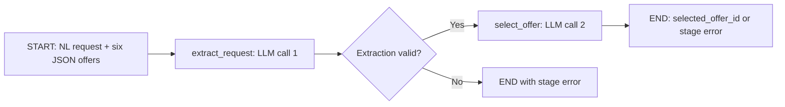

# Demo02: a two-step LangGraph agent

The agent receives an English delivery request and six structured supplier offers. It makes two sequential OCI Responses calls using the same model selected by `OCI_MODEL` in the root `.env`, and returns the same answer shape as Demo01:

```json
{"selected_offer_id": "..."}
```

## Workflow



The first node sees only the natural-language request and [extraction instructions](https://github.com/luigisaetta/agent-evals/blob/main/demo02/prompts/extract_request.md). It must return exactly:

```json
{
  "part_id": "PART-052",
  "delivery_location": "Vienna",
  "latest_delivery_date": "2027-08-06"
}
```

The extracted deadline is always the exclusive deadline: exclusive wording keeps the stated date, while inclusive ("no later than D") and relative ("N calendar days after A") wording are converted, as specified in [the v2 dataset specification](https://github.com/luigisaetta/agent-evals/blob/main/specs/demo02-extraction-difficulty.md). Part identifiers are normalized to `PART-NNN`. Missing, null, additional or duplicate fields, invalid dates, malformed JSON, and incomplete generations stop execution before the second call.

The second node combines the validated extracted request with the unchanged six offers. It reuses Demo01's [input validation, prompt builder and response parser](https://github.com/luigisaetta/agent-evals/blob/main/src/agent_evals/tasks/offer_selection.py). The model selects the offer; no deterministic ranking algorithm supplies its answer.

## Run one dataset case

Run from the repository root:

```sh
conda activate agent-evals
python -m pip install -r requirements.txt
PYTHONPATH=src python -m demo02.run_agent --case-id EO-054-L2
```

The CLI reads the request and offers from [the Demo02 v2 dataset](https://github.com/luigisaetta/agent-evals/blob/main/data/datasets/demo02-express-order-v2.json), whose IDs carry a difficulty level (`EO-054-L0`, `-L1`, `-L2`). Pass `--dataset data/datasets/demo02-express-order-v1.json` with an ID such as `EO-054` to use version 1. It ignores the case's expected output and scenario metadata. Successful stdout contains only the selected-offer JSON; stage failures are reported on stderr with a nonzero exit code.

Save intermediate details locally when needed:

```sh
PYTHONPATH=src python -m demo02.run_agent --case-id EO-054-L2 \
  --sleep-seconds 3 --details-file data/runs/demo02-details.json
```

`data/runs/` is ignored by Git. The optional details file contains the extracted request, actual step records, and output or safe failure diagnostics. Step records include response IDs, raw output, token usage when returned, status and elapsed duration. Step duration includes any inter-call pause inside the Responses callable.

Other options are `--dataset`, `--rules`, and `--env-file`. Exit codes are 0 for success, 1 for setup failure, and 2 for input/agent-stage failure.

## Use from Python

```python
from agent_evals.config import ROOT, load_settings
from agent_evals.oci_model import create_client
from demo02.agent import OfferSelectionAgent
from demo02.model import PacedResponses

settings = load_settings(ROOT / ".env")
rules = (ROOT / "rules/offer-selection.md").read_text()

with create_client(settings) as client:
    agent = OfferSelectionAgent(PacedResponses(client, settings), rules)
    output = agent.invoke(request_text, six_offer_objects)
```

`request_text` and `six_offer_objects` come from the caller's input. `invoke()` returns only the final answer; `run()` returns the successful graph state as well. Both raise `AgentExecutionError` when input validation or either stage fails. The exception exposes safe `error` fields and the records of attempted `steps`.

## Authentication, pacing and failure handling

The agent reuses the [shared OCI Responses transport](https://github.com/luigisaetta/agent-evals/blob/main/src/agent_evals/oci_model.py), including IAM user-principal signing through `~/.oci/config`. No provider API key is introduced. Both stages use the same configured model, output-token limit, timeout, and signed client.

`PacedResponses` applies `EVAL_SLEEP_SECONDS` (default two seconds) before every request after the first. A CLI override is supported. Reusing the same callable across agent invocations also preserves pacing between cases. Failed requests still count for the next pause. Automatic SDK/auth retries remain disabled; the graph does not perform repair or retry loops.

Input validation checks the NL string and all six offers before calling the model. Stage errors distinguish `api_error`, `invalid_output`, and `internal_error`; invalid original input uses `invalid_input`. Provider exception messages and authentication headers are not copied into error diagnostics. A failed extraction cannot fall through to selection, and a failed selection cannot return an invented answer.

Schema validation does not establish that an otherwise well-formed extraction is semantically correct. An incorrect but valid part, city or date can affect the selected offer. Measuring that behavior across the dataset is evaluation work beyond this single-agent implementation.

## Files and verification

| File | Responsibility |
| --- | --- |
| `agent.py` | Typed graph state, two nodes, conditional error exit and public agent interface |
| `contracts.py` | Input and extracted-request validation |
| `model.py` | Paced calls through the shared OCI Responses implementation |
| `prompts/extract_request.md` | First-stage extraction contract |
| `run_agent.py` | CLI for one selected dataset input |
| `evaluation.py` | Dataset adapter, graph invocation and per-step Langfuse generations |
| `evaluate.py`, `run_experiment.sh` | Named experiment entry points with compact progress |
| `agent-spec.md` | Scope and acceptance criteria |
| `evaluation-spec.md` | Evaluation and publication contract |

The automated suite executes the real compiled LangGraph with mocked provider responses. It checks stage order, intermediate failures, unchanged offers, output compatibility, source-reference isolation, pacing, and CLI behavior. Use `python -m pytest -q` from the root to run it.

Verification on 2026-11-09: all 83 automated tests passed. A live OCI smoke test on development case `EO-054` completed both Responses calls, extracted the original request correctly, and selected `EO-054-OFF-04`, matching the dataset reference. This single-case check does not establish dataset-wide accuracy.

## Evaluate and publish to Langfuse

Use the dedicated launcher from the repository root. An experiment name is
mandatory; Langfuse publication is enabled by default using the root `.env`:

```sh
# Validate all inputs and provenance without model calls or uploads.
./demo02/run_experiment.sh "Demo02 validation" --dry-run --split all

# Run all 300 v2 records (L0, L1, L2), making up to 600 Responses calls.
./demo02/run_experiment.sh "Demo02 baseline" --split all

# Run only the 240 held-out records (the default split).
./demo02/run_experiment.sh "Demo02 evaluation" --sleep-seconds 3

# Make real OCI calls for one development case, without Langfuse.
./demo02/run_experiment.sh "Demo02 local smoke" \
  --split development --limit 1 --no-langfuse
```

The equivalent Python entry point is
`PYTHONPATH=src python -m demo02.evaluate --experiment-name "Demo02 baseline" --split all`.
Options also include `--dataset`, `--rules`, `--env-file`, and `--output-dir`.
`--dry-run` makes no external calls; `--no-langfuse` still invokes OCI.
The single-case `run_agent.py` above remains usable without tracing or evaluation.

The CLI shares Demo01's project banner and numbered startup activities. A single
progress bar updates completed **cases**, with live `OK` and `KO` counters;
it does not print a status line for each case. At the end it logs the IDs,
statuses and failing stages of KO cases, or `KO case IDs: none`. For example:

```text
Evaluating cases: 100%|██████████| 100/100 [..., KO=3, OK=97]
Completed: OK=97 KO=3
KO case IDs:
  EO-010: incorrect
  EO-020: invalid_output, stage=extract_request
  EO-030: api_error, stage=select_offer
```

These counts are illustrative. OK means the selected ID matches the reference;
KO includes valid wrong answers and all execution failures. A failed extraction
stops that case before selection; subsequent cases continue. A single paced
caller is reused across the complete experiment, so the configured sleep
applies between the two nodes and between cases without an extra runner delay.

### Results and model identity

Each run writes `metadata.json`, `results.jsonl` and `summary.json` to ignored
`data/runs/<run-id>/`. Run metadata records the configured model, region, token
limit, sleep, SDK versions, dataset/rules/selection-prompt hashes, and hashes of
Demo02's Python files and extraction prompt. Each test result also contains:

```json
{
  "case_id": "EO-054",
  "metadata": {
    "model": "<configured OCI_MODEL>",
    "task_name": "demo02-offer-selection"
  },
  "output": {"selected_offer_id": "EO-054-OFF-04"},
  "status": "correct",
  "score": 1
}
```

Actual records retain the original scenario metadata, expected output, extracted
request, both attempted-step records, response IDs, raw outputs, total usage,
latency and safe errors. Summary metadata also includes `model`, `ok_count`,
`ko_count` and `ko_cases`, alongside status counts and the experiment URL.
Unattempted cases are reported separately, rather than counted as KO.

`accuracy` is correctness over valid scored answers; `success_rate_all_attempts`
includes failures in its denominator. API errors, invalid outputs, agent internal
errors and evaluator errors are unscored. A valid wrong answer scores zero.
Exit codes retain the common runner's convention: 0 for completion, including
valid wrong answers; 1 for setup/publication/incomplete-run failure; 2 for model,
agent or evaluator execution errors. Inspect KO counts to assess quality; no
experiment acceptance threshold is imposed.

### Dataset versions

The default dataset is [version 2](https://github.com/luigisaetta/agent-evals/blob/main/docs/demo02-dataset.md#version-2-graded-extraction-difficulty)
(300 records with graded extraction difficulty). Use `--dataset
data/datasets/demo02-express-order-v1.json` for the 100 version 1 cases. Each v2
result stores the reference `expected_output.expected_request` next to the
agent's `extracted_request`, so extraction errors can be inspected locally;
extraction is not yet a separate score. Compare results per level with
`metadata.level`.

### What is published

Langfuse receives the selected dataset inputs, references and scenario metadata
under the dedicated `demo02-express-order-<split>-<dataset hash>` namespace;
the hash distinguishes dataset versions.
Stable item IDs avoid duplicates on repeat uploads. The named experiment links
each case to its result and these scores:

| Score | Meaning |
| --- | --- |
| `selection_correct` | Exact final ID match, only for valid scored answers |
| `valid_output` | Whether the complete pipeline produced a valid final answer |
| `execution_status` | Correct, incorrect, or a classified execution failure |

Each successful case has two child **GENERATION** observations:
`demo02-extract_request` and `demo02-select_offer`. They include actual
instructions, inputs, raw outputs, model, token usage and validated stage status.
A failed extraction has only its attempted generation, with error status.
The experiment metadata and returned result metadata both record `model`.
Expected answers and scenario metadata never enter either model prompt.

Local outputs survive observation update and final flush failures, which mark
publication as failed. `submitted_unverified` means SDK submission and flush
completed; it does not claim independently verified remote ingestion. Inspect
the printed experiment URL for results and expand its traces to see both nodes.

Verification on 2026-11-09: **89 automated tests passed**. A separate live run on
one development case (`EO-054`) returned the expected selection using
`openai.gpt-oss-20b`. Read-only Langfuse API checks confirmed the persisted
experiment item, model metadata, correctness/validity/status scores and exactly
two generation observations with the configured model. No full-dataset accuracy
claim follows from this smoke test.

The root `run_experiment.sh` continues to launch Demo01 by default. Future demos
follow the folder and adapter conventions in the
[task adaptation guide](https://github.com/luigisaetta/agent-evals/blob/main/docs/adapting-tasks.md).
